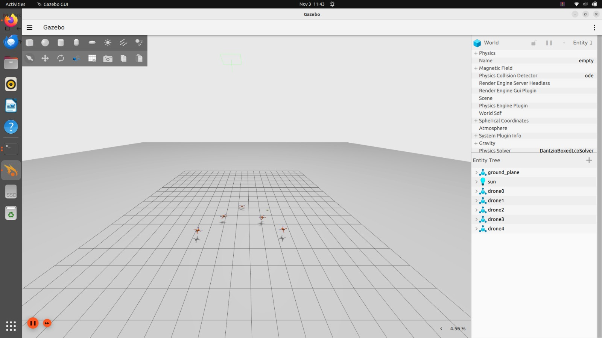
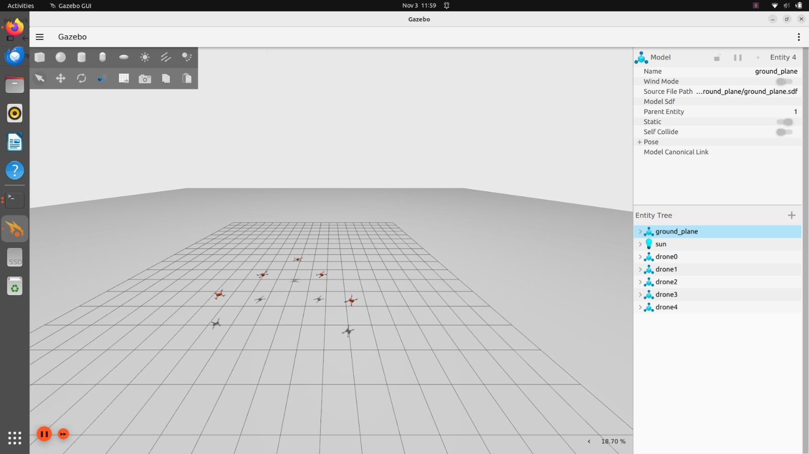
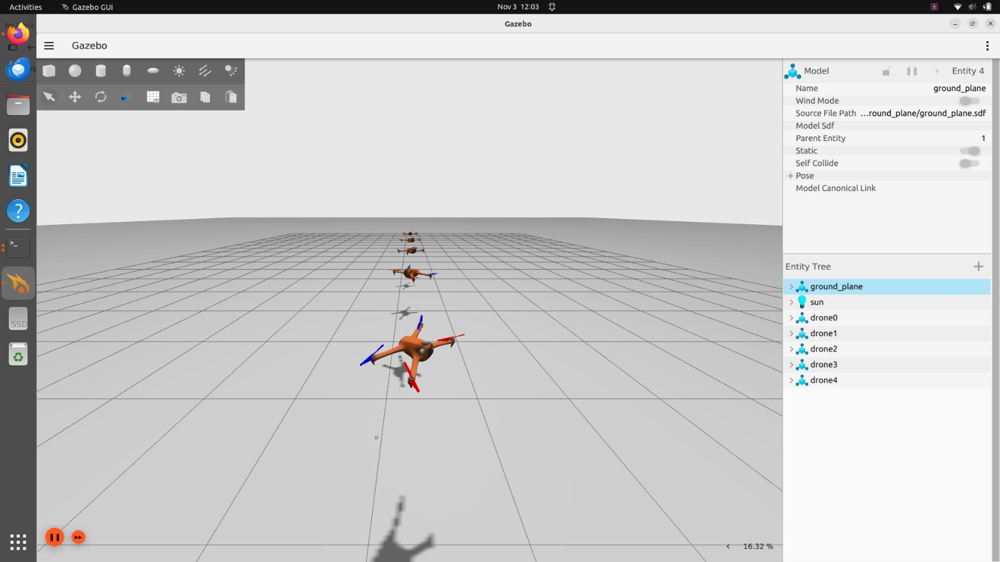
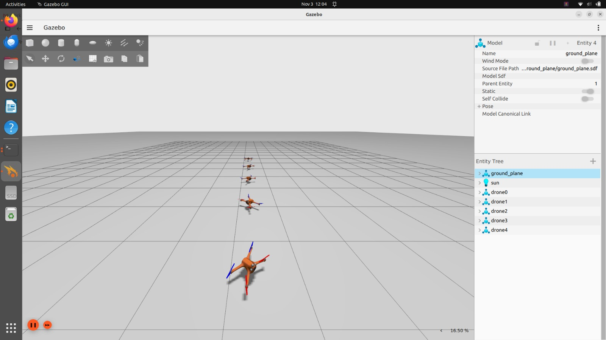
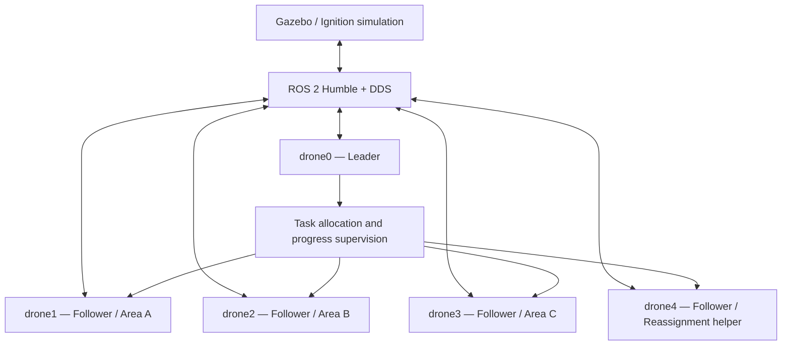

<div align="center">

# Five-Drone Leader–Follower Formation
## Dynamic Multi-Drone Area Survey with Task Reallocation

**ROS 2 Humble · AeroStack2 · Gazebo / Ignition · Python · DDS**

A five-UAV simulation project demonstrating formation control, distributed coordination,
multi-area waypoint assignment, progress reporting, and delay-triggered task reassignment.

[Demonstration videos](#-simulation-demonstrations) ·
[Architecture](#-system-architecture) ·
[Quick start](#-quick-start) ·
[Documentation](#-documentation)

</div>

---

## Project overview

This project develops and documents a five-drone coordination system in simulation.
The fleet consists of one leader (`drone0`) and four followers (`drone1`–`drone4`).
The project explores several control and coordination approaches, from direct
pose-feedback control to ROS 2 topic-based leader–follower execution and
leader-managed survey tasks.

The task-allocation implementation assigns three survey areas to three followers.
A programmed delay event can cause the leader to transfer the unfinished waypoints
to an available helper drone. This is a simulated delay/reassignment scenario;
it is not an autonomous real-world fault-detection or safety-certified system.

> **Scope:** Simulation and software demonstration only. No physical-drone flight
> validation or safety certification is claimed.

## Highlights

- Five simulated quadrotors with consistent `drone0`–`drone4` namespaces.
- Line and V/arrow formation layouts.
- A high-level AeroStack2 `DroneInterface` implementation.
- A direct pose-feedback / velocity-command implementation.
- A distributed ROS 2 leader–follower implementation using DDS topics.
- Leader-assigned survey tasks over areas A, B and C.
- Follower progress events and delay-triggered transfer of remaining waypoints.
- Gazebo screenshots, two demonstration recordings, technical documentation and report.

## Simulation demonstrations

Click either image to open its corresponding MP4 recording in GitHub.

| Leader–follower formation | Survey and task reallocation |
|:--:|:--:|
| [](assets/videos/demo_formation.mp4) | [](assets/videos/demo_survey_reallocation.mp4) |
| Takeoff, line and V/arrow formation, landing | Area assignment, injected delay and reassignment demonstration |

## Gazebo simulation gallery

| Line formation — front | Line formation — rear |
|:--:|:--:|
|  |  |

| V/arrow formation | Survey altitude separation |
|:--:|:--:|
|  |  |

| Column formation |
|:--:|
|  |

*Images and recordings are supplied project artifacts captured from the Gazebo simulation.*

## System architecture



### Main ROS 2 interfaces

| Topic | Message type | Role |
|---|---|---|
| `/formation/command` | `std_msgs/String` | Formation command broadcast in the DDS formation variant |
| `/formation/leader_pose` | `geometry_msgs/PoseStamped` | Leader position reference |
| `/formation/task/droneN` | `std_msgs/String` containing JSON | Individual follower task |
| `/formation/status` | `std_msgs/String` containing JSON | Follower progress/status event |
| `/droneN/ground_truth/pose` | `geometry_msgs/PoseStamped` | Simulation pose feedback |
| `/gz/droneN/cmd_vel` | `geometry_msgs/Twist` | Gazebo velocity-command interface used by direct-control variants |

The topic names above describe the interfaces used by the submitted programs.
The exact availability of topics depends on the running simulation, bridges and
AeroStack2/Gazebo configuration.

## Control and coordination variants

These are separate implementations and should be launched independently.
Do not run multiple controllers against the same drones at the same time.

| Program | Approach | Main demonstration |
|---|---|---|
| `leader_follower_command_demo.py` | AeroStack2 `DroneInterface` | High-level takeoff, line/V formation and landing commands |
| `direct_formation.py` | Centralised pose feedback and velocity commands | Direct five-drone formation control |
| `leader_follower_dds.py` | Separate leader/follower ROS 2 processes | Distributed formation commands over DDS |
| `leader_tasks.py` | Individual task topics and shared status topic | Survey assignment, progress reporting and reassignment |

### Formation geometry

The DDS/task implementations use fixed follower offsets relative to the leader.

| Drone | Line offset (m) | V/arrow offset (m) |
|---|---:|---:|
| `drone0` (leader) | `(0, 0)` | `(0, 0)` |
| `drone1` | `(-1.5, 0)` | `(-1.5, +1.5)` |
| `drone2` | `(-3.0, 0)` | `(-1.5, -1.5)` |
| `drone3` | `(-4.5, 0)` | `(-3.0, +3.0)` |
| `drone4` | `(-6.0, 0)` | `(-3.0, -3.0)` |

### Survey allocation

| Drone | Initial responsibility |
|---|---|
| `drone1` | Area A |
| `drone2` | Area B |
| `drone3` | Area C |
| `drone4` | Available helper |
| `drone0` | Mission coordination |

Each survey area is represented by four waypoints in `leader_tasks.py`.
The delay scenario is triggered by the task program and reports the remaining
waypoints to the leader. The leader selects an idle helper and sends it the
unfinished work.

## Repository layout

```text
.
├── README.md
├── LICENSE
├── .gitignore
├── config/
│   ├── fastdds_udp_only.xml
│   └── world_swarm_5drone.yaml
├── leader_follower_command_demo.py
├── direct_formation.py
├── leader_follower_dds.py
├── leader_tasks.py
├── launch_as2_5drone.bash
├── run_leader_follower.sh
├── run_leader_tasks.sh
├── stop.bash
├── docs/
│   ├── Technical_Documentation.md
│   └── Technical_Report.pdf
└── assets/
    ├── images/
    └── videos/
```

The launcher also expects supporting AeroStack2 project resources such as
`utils/get_drones.py`, `utils/stop_tmux_sessions.bash` and
`tmuxinator/aerostack2.yaml`. These are not duplicated in this repository.
They must be available in the surrounding AeroStack2 project workspace.

## Requirements and environment

The supplied documentation describes the development environment as:

- Ubuntu 22.04
- ROS 2 Humble
- AeroStack2 workspace
- Gazebo / Ignition Gazebo version compatible with the installed AeroStack2 setup
- Python 3 and `rclpy`
- ROS message packages: `geometry_msgs`, `std_msgs`
- `tmux` and `tmuxinator` for the multi-agent launcher
- Fast DDS configuration support

The repository does not install ROS 2 or AeroStack2 automatically. Install and
build those dependencies using their official project instructions first.

## Quick start

### 1. Clone the repository

```bash
git clone https://github.com/rishivexe-alt/Five-Drone-Leader-Follower-Formation-and-Dynamic-Multi-Drone-Area-Survey-with-Task-Reallocation.git
cd Five-Drone-Leader-Follower-Formation-and-Dynamic-Multi-Drone-Area-Survey-with-Task-Reallocation
```

### 2. Source ROS 2 and AeroStack2

Adjust the AeroStack2 workspace path if yours differs.

```bash
source /opt/ros/humble/setup.bash
source ~/aerostack2_ws/install/setup.bash
```

### 3. Prepare the project workspace

The launcher expects to run from the root of the AeroStack2 Gazebo project workspace,
which must contain the supporting `utils/` and `tmuxinator/` resources described above.
Place or integrate the files from this repository into that workspace, preserving:

```text
config/world_swarm_5drone.yaml
config/fastdds_udp_only.xml
```

Set the Fast DDS profile in each terminal that runs the project:

```bash
export FASTRTPS_DEFAULT_PROFILES_FILE="$PWD/config/fastdds_udp_only.xml"
export FASTDDS_DEFAULT_PROFILES_FILE="$PWD/config/fastdds_udp_only.xml"
```

### 4. Launch the five-drone simulation

From the AeroStack2 project workspace root, where `utils/` and `tmuxinator/` are available:

```bash
chmod +x launch_as2_5drone.bash
./launch_as2_5drone.bash -m
```

The `-m` option selects the five-drone world configuration. The launch script uses
the project’s tmuxinator configuration to start the drone sessions.

### 5. Run one control variant

Start only one controller variant at a time, after confirming that all required
drone models and topics are available.

**A. AeroStack2 command demo**

```bash
python3 leader_follower_command_demo.py
```

Commands: `TAKEOFF`, `LINE`, `V_FORMATION`, `LAND`, `EXIT`.

**B. Direct formation controller**

```bash
python3 direct_formation.py
```

Commands: `TAKEOFF`, `LINE`, `V_FORMATION`, `LAND`, `EXIT`.

**C. DDS leader–follower formation**

```bash
chmod +x run_leader_follower.sh
./run_leader_follower.sh
```

Leader commands: `1` (LINE), `2` (ARROW), `T` (TAKEOFF), `L` (LAND),
`g dx dy` (move leader), `q` (quit).

**D. Survey task allocation and reassignment**

```bash
chmod +x run_leader_tasks.sh
./run_leader_tasks.sh
```

The leader command interface includes `T`, `L`, `1`, `2`, `mission`,
`mission delay`, `status`, `assign`, `g dx dy` and `q`.
The delay scenario is a programmed demonstration event.

### 6. Shutdown

Land the simulated vehicles using the active controller before stopping the
simulation. The supplied `stop.bash` script also relies on the surrounding
AeroStack2 workspace utilities. Review the script before running it because
it terminates simulation-related processes.

## Configuration notes

- `config/world_swarm_5drone.yaml` defines the `empty` world and five
  `quadrotor_base` vehicles with GPS payloads.
- `config/fastdds_udp_only.xml` defines a UDPv4 transport profile.
- The launch script references `config/world.yaml` for its non-swarm mode.
  That file is not included because this repository packages the five-drone
  configuration only.

## Validation status and limitations

The uploaded Python files were checked for Python syntax, and the uploaded Bash
scripts were checked with `bash -n`. These checks do not prove runtime operation.

The screenshots, videos, technical report and technical documentation are
included as project evidence. Performance values and simulation outcomes should
be interpreted in the context and conditions documented in those materials.

Known boundaries:

- The delay/reallocation scenario is programmed; automatic detection of real
  vehicle failures is future work.
- The submitted controllers use simulation pose feedback and/or the interfaces
  documented in the technical report.
- Collision avoidance, obstacle avoidance, robust fault detection and real
  aircraft validation are not claimed as completed capabilities.
- The launcher depends on surrounding AeroStack2 project utilities not included
  in this repository.

## Troubleshooting

**No drone namespaces appear**

Check the world YAML, `utils/get_drones.py`, tmuxinator configuration and the
AeroStack2 workspace environment.

**A drone exists but does not move**

Check its pose topic, command topic, Gazebo bridge and controller/plugin state
before changing controller gains.

**ROS 2 nodes cannot communicate**

Confirm that all terminals source the same ROS 2 and AeroStack2 environments
and use the intended Fast DDS profile.

**A follower does not respond to a task**

Check the follower process, its namespace, `/formation/task/droneN`, the
leader-pose topic where relevant, and `/formation/status`.

## Documentation

- [Technical Documentation](docs/Technical_Documentation.md) — setup, architecture,
  communication, program operation, diagnostics and handover notes.
- [Technical Report (PDF)](docs/Technical_Report.pdf) — detailed project report
  and source listings.

## Future work

- Add heartbeat/progress-timeout based delay and failure detection.
- Improve task reassignment policy and helper selection.
- Add collision avoidance and obstacle-aware planning.
- Replace ground-truth feedback with onboard state estimation.
- Add repeatable automated test scenarios and measured reassignment latency.
- Explore hardware-in-the-loop and real-flight validation.

## Author

**Rishi P.**  
Electronics & Communication Engineering  
GitHub: [@rishivexe-alt](https://github.com/rishivexe-alt)  
LinkedIn: [rishi-p2105](https://www.linkedin.com/in/rishi-p2105/)

## License

This project is distributed under the MIT License. See [LICENSE](LICENSE).
