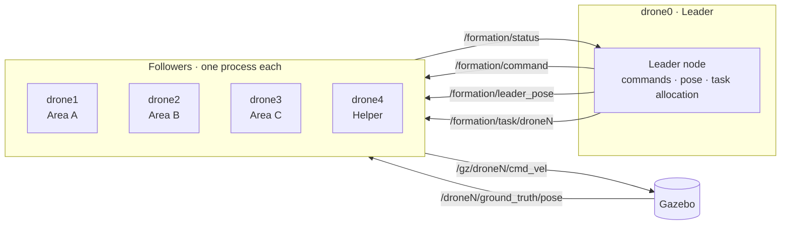
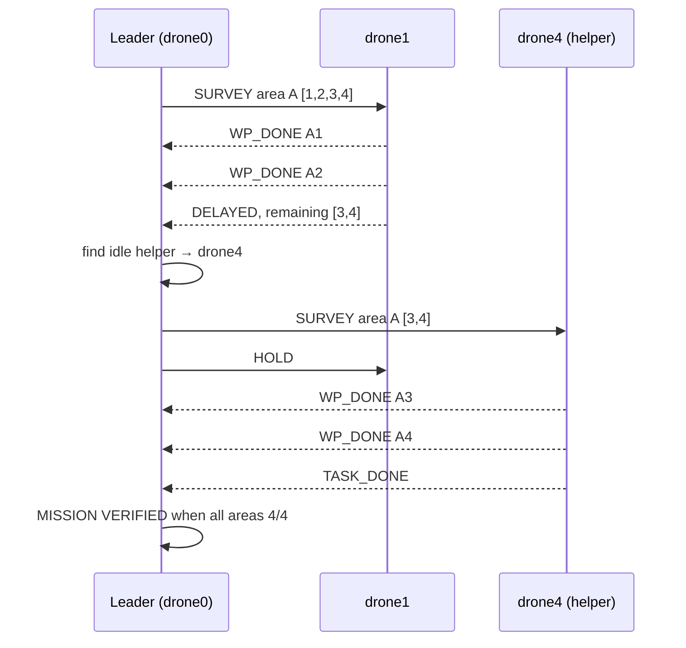

<div align="center">

#  Five-Drone Leader–Follower Formation & Dynamic Area Survey

---

##  Overview

This project delivers a **five-drone leader–follower coordination system** developed and demonstrated entirely in simulation. It goes beyond formation flight: the leader also **assigns independent survey areas to individual followers, monitors their progress, and automatically reassigns unfinished work** to a spare drone when a follower reports a delay.

**drone0** is the leader; **drone1 – drone4** are followers. Every leader–follower interaction is a ROS 2 topic over DDS, so each drone runs as an independent process and can be inspected on its own.

###  Key Features

| | Feature |
|---|---|
| 1 | **Line and V/arrow formations** defined as fixed offsets from the leader |
| 2 | **Clipped proportional controller** with separate climb/descent limits for bounded, traceable motion |
| 3 | **Four control paths**: AeroStack2 high-level API, centralised direct control, distributed DDS, and task-based allocation |
| 4 | **Fully distributed execution**: one process per follower, communicating only through ROS 2 topics |
| 5 | **Per-drone survey tasks** (areas A, B, C) sent on private task topics as JSON |
| 6 | **Delay-triggered reallocation**: unfinished waypoints move from a delayed drone to an idle helper |
| 7 | **Altitude separation**: each drone flies at its own flight level during surveys |
| 8 | **Documented diagnostics**: layered troubleshooting from model spawn to controller response |

---

##  Demo Videos

Click a thumbnail to open the recording.

| Leader–Follower Formation | Dynamic Survey with Task Reallocation |
|:---:|:---:|
| [](assets/videos/demo_formation.mp4) | [](assets/videos/demo_survey_reallocation.mp4) |
| Takeoff → Line → V/Arrow → Line → Land | Areas A/B/C assigned, delay injected, A3/A4 transferred to drone4 |
| [`demo_formation.mp4`](assets/videos/demo_formation.mp4) | [`demo_survey_reallocation.mp4`](assets/videos/demo_survey_reallocation.mp4) |

---

##  Simulation Gallery

All frames are captured from the Gazebo simulation with drone0 to drone4 spawned in the world.

| Line formation (front view) | Line formation (rear view) |
|:---:|:---:|
|  |  |

| V / arrow formation | Survey with altitude separation |
|:---:|:---:|
|  |  |

| Airborne formation, shadows showing height |
|:---:|
|  |

---

##  System Architecture

The system is split into layers so that a fault can be traced to one layer instead of being guessed at.

| Layer | Responsibility | Implementation |
|---|---|---|
| **Simulation** | Vehicle models, physics, Gazebo topics | Gazebo / Ignition |
| **Vehicle abstraction** | Arm, offboard, takeoff, go-to, land | AeroStack2 `DroneInterface` |
| **Motion control** | Pose feedback → velocity commands | `direct_formation.py`, DDS program |
| **Coordination** | Leader commands and pose distribution | `leader_follower_dds.py` |
| **Task execution** | Individual survey tasks, waypoint tracking | `leader_tasks.py` |



### Communication Interfaces

| Topic | Message type | Function |
|---|---|---|
| `/formation/command` | `std_msgs/String` | Leader broadcasts a formation or flight command |
| `/formation/leader_pose` | `geometry_msgs/PoseStamped` | Leader publishes its pose as the formation reference |
| `/formation/task/droneN` | `std_msgs/String` (JSON) | Leader sends an individual task to follower N |
| `/formation/status` | `std_msgs/String` (JSON) | Followers report progress and task status |
| `/droneN/ground_truth/pose` | `geometry_msgs/PoseStamped` | Ground-truth position feedback |
| `/gz/droneN/cmd_vel` | `geometry_msgs/Twist` | Velocity command interface to Gazebo |

---

##  Formation Control

Formation is a **fixed (x, y) offset from the leader**, held at a common altitude. Each follower converges on `leader position + offset`.

| Drone | Line offset (m) | V / Arrow offset (m) |
|---|---|---|
| drone0 (leader) | (0, 0) | (0, 0) |
| drone1 | (−1.5, 0) | (−1.5, +1.5) |
| drone2 | (−3.0, 0) | (−1.5, −1.5) |
| drone3 | (−4.5, 0) | (−3.0, +3.0) |
| drone4 | (−6.0, 0) | (−3.0, −3.0) |

### Controller

```
e = target − position
vx = clip(Kp · ex, V_XY)      vy = clip(Kp · ey, V_XY)
vz = clip(2·Kp · ez, V_UP or V_DN)
```

| Parameter | Value |
|---|---|
| Target altitude | 1.05 m |
| Ground reference | 0.06 m |
| Proportional gain `Kp` | 0.8 |
| Horizontal velocity limit | 0.6 m/s |
| Upward / downward velocity limit | 0.5 / 0.4 m/s |
| Position tolerance | 0.15 m (0.2 m in the task program) |

Velocity clipping matters as much as the gain: it keeps the response bounded and makes descent slower than climb. The vertical term is doubled so altitude converges faster than horizontal position.

---

##  Dynamic Area Survey and Task Reallocation

### Survey areas

| Area | Initial owner | Waypoints (x, y), m |
|---|---|---|
| A | drone1 | (−2.5, −2.0) → (−2.5, 2.0) → (−1.0, 2.0) → (−1.0, −2.0) |
| B | drone2 | (−0.5, −2.0) → (−0.5, 2.0) → (0.5, 2.0) → (0.5, −2.0) |
| C | drone3 | (1.0, −2.0) → (1.0, 2.0) → (2.5, 2.0) → (2.5, −2.0) |
| Helper | drone4 | Available for reassignment |

Each drone flies at its own altitude: **1.05 m + 0.3 m per drone index** (drone1 1.05 m, drone2 1.35 m, drone3 1.65 m, drone4 1.95 m).

### Task types

`TAKEOFF` · `LAND` · `HOLD` · `LINE` · `ARROW` · `GOTO` · `SURVEY`

### Delay-triggered reallocation



**Recorded leader output:**

```text
[LEADER] drone1 finished A1
[LEADER] drone1 finished A2
[LEADER] drone1 reports DELAY, remaining A waypoints [3, 4]
[LEADER] TRANSFER: drone1 -> drone4, area A
[LEADER] -> drone4: SURVEY area A waypoints [3, 4]
[LEADER] -> drone1: HOLD
[LEADER] drone4 finished A3
[LEADER] drone4 finished A4
[LEADER] drone4 finished its task
```

The design separates **deciding** who does the work (the leader) from **doing** it (the followers). The leader can task one drone without broadcasting to the fleet and learns progress through the shared status topic.

---

##  Program Variants

| File | Approach | Demonstrates |
|---|---|---|
| `leader_follower_command_demo.py` | AeroStack2 `DroneInterface` | High-level vehicle behaviour orchestration |
| `direct_formation.py` | Pose feedback + Gazebo velocity | Centralised direct formation controller |
| `leader_follower_dds.py` | Leader/follower ROS 2 processes | Distributed formation command execution |
| `leader_tasks.py` | Task topics + status topic | Distributed task execution and leader reassignment |
| `run_leader_follower.sh` | Bash | Starts the DDS formation processes |
| `run_leader_tasks.sh` | Bash | Starts the task-management processes |

---

##  Quick Start

### Prerequisites

- Ubuntu 22.04
- ROS 2 Humble
- AeroStack2 workspace at `~/aerostack2_ws`
- Gazebo / Ignition Gazebo (Fortress)
- Python 3 with `rclpy`
- `tmux`

### 1. Set up the environment

```bash
source /opt/ros/humble/setup.bash
source ~/aerostack2_ws/install/setup.bash
export FASTRTPS_DEFAULT_PROFILES_FILE="$HOME/project_gazebo/config/fastdds_udp_only.xml"
export FASTDDS_DEFAULT_PROFILES_FILE="$HOME/project_gazebo/config/fastdds_udp_only.xml"
export ROS2CLI_DISABLE_DAEMON=1
cd ~/project_gazebo
```

### 2. Launch the five-drone simulation

```bash
./launch_as2_5drone.bash -m
tmux list-sessions        # expect drone0 … drone4
```

### 3. Run **one** control variant

Start the simulation first, then run exactly one of the following.

<details>
<summary><b>A. AeroStack2 command demo</b></summary>

```bash
python3 leader_follower_command_demo.py
```
Commands: `TAKEOFF`, `LINE`, `V_FORMATION`, `LAND`, `EXIT`
</details>

<details>
<summary><b>B. Direct formation controller</b></summary>

```bash
python3 direct_formation.py
```
Commands: `TAKEOFF`, `LINE`, `V_FORMATION`, `LAND`, `EXIT`
</details>

<details>
<summary><b>C. DDS leader–follower formation</b></summary>

```bash
chmod +x run_leader_follower.sh
./run_leader_follower.sh
```
Leader commands: `1` LINE · `2` ARROW · `T` TAKEOFF · `L` LAND · `g dx dy` move leader · `q` quit

Recorded demo sequence: `T` → `1` → `2` → `1` → `L`
</details>

<details>
<summary><b>D. Task allocation with delay reassignment</b></summary>

```bash
chmod +x run_leader_tasks.sh
./run_leader_tasks.sh
```
Typical session:
```text
T                 # take off
mission delay     # assign A/B/C and inject a delay on drone1
status            # show per-area progress
L                 # land
```
Other commands: `1`, `2`, `mission`, `assign N HOLD|LAND|LINE|ARROW|GOTO x y z`, `g dx dy`, `status`, `q`
</details>

### 4. Stop the simulation

Land all drones first, then:

```bash
./stop.bash
```

---

##  Verified Results

Recorded maximum position errors from the simulation runs:

| Operation | Max position error |
|---|---|
| Takeoff | 0.03 m |
| Line formation | 0.04 m |
| V formation | 0.02 m |
| Landing | 0.05 m |

| Test area | Outcome |
|---|---|
| Takeoff / landing | Demonstrated |
| Line formation | Demonstrated |
| V / arrow formation | Demonstrated |
| DDS command path | Demonstrated |
| Survey allocation (A/B/C) | Implemented and demonstrated |
| Delay handling | A3/A4 transferred to drone4 and completed |

---

##  Engineering Diagnosis Highlights

Every integration issue was diagnosed layer by layer instead of changing several things at once.

- **Plugin compatibility:** the Fortress-compatible `ignition-gazebo-multicopter-control-system` loaded and responded; the `gz-sim`-prefixed name did not exist in that environment.
- **Spawn sequencing:** manual `ros_gz_sim create` was used to isolate model-spawn faults from controller faults.
- **Command-to-response tracing:** ROS publisher → bridge / Gazebo topic → controller enable → observed pose.
- **Real-time factor:** a low factor means wall-clock durations don't match simulation time, which affects how takeoff and movement timing is read.
- **Model validation:** generated SDF files were checked for well-formed XML and plugin presence.

Useful diagnostics:

```bash
ign model --list
ign topic -l
ros2 topic echo /drone0/ground_truth/pose --once
ros2 topic echo /drone0/platform/info --once

for d in 0 1 2 3 4; do
  echo "drone$d"
  timeout 8 ros2 topic echo /drone$d/ground_truth/pose --once | grep -A3 "position"
done
```

Follower logs are written to `/tmp/follower1.log` … `/tmp/follower4.log`.

---


##  Future Work

- Replace ground-truth pose with onboard estimation and add sensor noise
- Add inter-drone collision avoidance and obstacle handling
- Detect delays and failures automatically (heartbeat or progress timeouts) instead of injecting them
- Use cost-based reallocation among several helpers, with measured reassignment latency
- Hardware-in-the-loop and real-flight validation

---

##  Repository Structure

```text
five-drone-swarm/
├── README.md
├── LICENSE
├── launch_as2_5drone.bash
├── stop.bash
├── config/
│   ├── world_swarm_5drone.yaml
│   └── fastdds_udp_only.xml
├── leader_follower_command_demo.py
├── direct_formation.py
├── leader_follower_dds.py
├── leader_tasks.py
├── run_leader_follower.sh
├── run_leader_tasks.sh
├── docs/
│   ├── Technical_Report.pdf
│   └── Technical_Documentation.md
└── assets/
    ├── images/        # Gazebo screenshots
    └── videos/        # Demo screencasts
```

##  Documentation

- [Technical Report (PDF)](docs/Technical_Report.pdf): summary, design, results and full source listings
- [Technical Documentation (Markdown)](docs/Technical_Documentation.md): detailed design, operations, diagnostics and handover checklist

## License

MIT — see [LICENSE](LICENSE).

## Author

**Rishi P.**  
Electronics & Communication Engineering  
---
