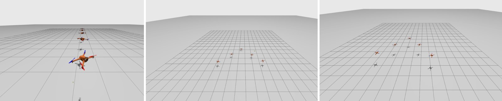
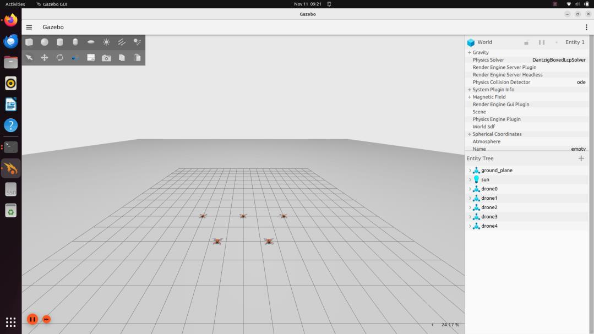
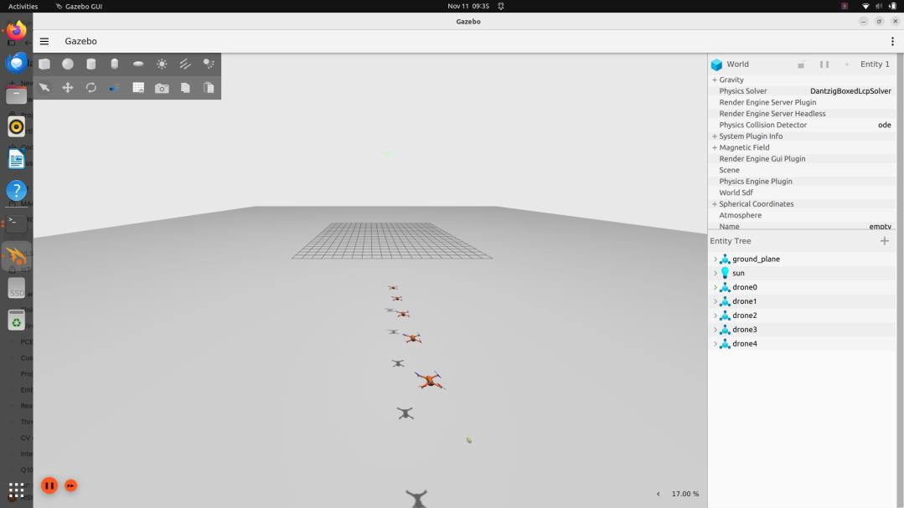
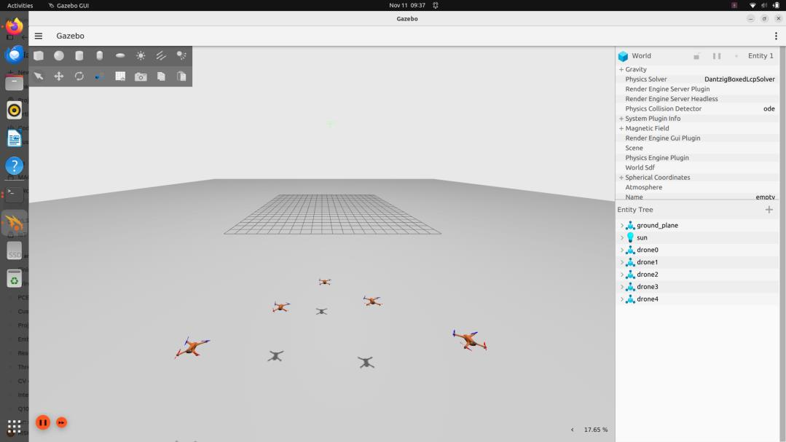
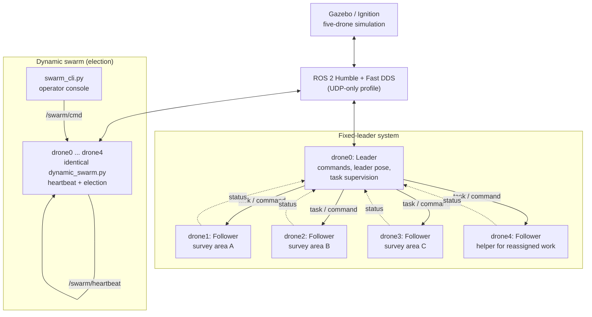
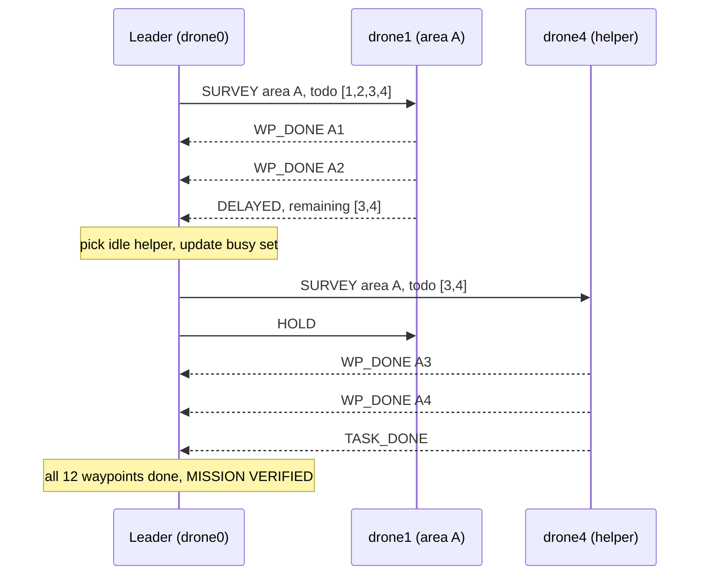
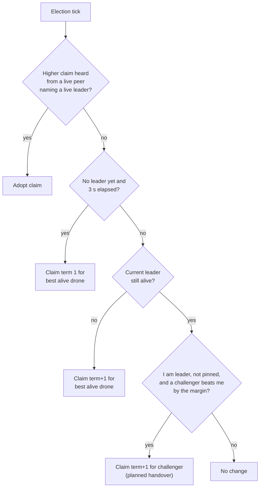

<div align="center">

# AeroNexus

### Five-Drone Leader–Follower Formation, Dynamic Area Survey with Task Reallocation, and Self-Organising Leader Election

**ROS 2 Humble · AeroStack2 · Gazebo / Ignition Fortress · Python · Fast DDS**




*Five simulated quadrotors flying line and V formations, surveying separate areas at separate altitudes, and re-electing their own leader.*

</div>

---


## Overview

AeroNexus is a multi-UAV coordination project built entirely in simulation. A fleet of five quadrotors (`drone0`–`drone4`) is coordinated over **ROS 2 topics and DDS**, with every drone running as an independent process.

The project is built in layers, so each layer can be developed, run and diagnosed on its own:

| Stage | What it adds |
|---|---|
| **Vehicle control** | A high-level AeroStack2 path and a low-level velocity-feedback path |
| **Formation flight** | Line and V/arrow formations with a leader that followers track live |
| **Mission layer** | The leader assigns survey areas, followers report progress, and unfinished waypoints are moved to a helper drone |
| **Resilience layer** | No fixed leader: all five drones run the same program and elect a leader from heartbeats, with failover, battery-based handover and manual override |

---

## Key features

- **Five-drone swarm** with consistent `drone0`–`drone4` namespaces and one log per process.
- **Line and V/arrow formations** defined as fixed offsets from the leader.
- **Two vehicle-control paths:** the AeroStack2 `DroneInterface` (arm, offboard, takeoff, GoTo, land) and a direct pose-feedback controller publishing Gazebo velocity commands.
- **Distributed leader–follower execution** over DDS: followers track the leader's live pose at 20 Hz.
- **Individual survey tasks** sent as JSON over per-drone topics, with progress reporting (`WP_DONE`, `DELAYED`, `TASK_DONE`).
- **Delay-triggered task reallocation:** unfinished waypoints are transferred to a spare drone while the delayed drone holds.
- **Altitude-separated flight levels** to keep drones from sharing a flight level.
- **Dynamic leader election** (term-based, Raft-inspired, with no voting rounds) using 10 Hz heartbeats, with three selection criteria: `battery`, `id` and `centroid`.
- **Manual leader pinning** with `leader N`, while failure failover stays active.

---

## Demonstrations

| Leader–follower formation | Survey and task reallocation |
|:--:|:--:|
| [](assets/videos/demo_formation.mp4) | [](assets/videos/demo_survey_reallocation.mp4) |
| Takeoff, line, V/arrow, landing | Area assignment, injected delay and reassignment |

### Simulation gallery

| Line formation, front | Line formation, rear |
|:--:|:--:|
|  |  |

| V / arrow formation | Column formation |
|:--:|:--:|
|  |  |

| Survey with altitude separation |
|:--:|
|  |

### Dynamic leader election

| Five drones spawned | Dynamic line behind the elected leader | Dynamic V behind the elected leader |
|:--:|:--:|:--:|
|  |  |  |

*All images and recordings are captured from the Gazebo simulation.*

---

## System architecture



The layers and what implements them:

| Layer | Responsibility | Implementation |
|---|---|---|
| Simulation | Vehicle models, physics, simulator topics | Gazebo / Ignition |
| Vehicle abstraction | Arm, offboard, takeoff, GoTo, land | AeroStack2 `DroneInterface` |
| Motion control | Pose feedback, target calculation, velocity generation | `direct_formation.py` and the DDS programs |
| Coordination | Leader commands and leader-pose distribution | `leader_follower_dds.py` |
| Task execution and supervision | Survey tasks, status, reassignment | `leader_tasks.py` |
| Role management | Election, manual override, failover | `election.py`, `dynamic_swarm.py`, `swarm_cli.py` |

**Design principle:** the leader never calls follower code directly or shares memory with it. Every interaction is a ROS 2 topic, so any drone can be inspected, restarted or replaced on its own.

---

## How it works

### 1. Formation control

Formation geometry is a set of fixed horizontal offsets from the leader (flight direction is +x). Each follower computes `target = leader position + offset` and converges on it with a clipped proportional controller.

| Slot | Line offset (x, y) m | V / arrow offset (x, y) m |
|:--:|:--:|:--:|
| Leader | (0, 0) | (0, 0) |
| 1 | (−1.5, 0) | (−1.5, +1.5) |
| 2 | (−3.0, 0) | (−1.5, −1.5) |
| 3 | (−4.5, 0) | (−3.0, +3.0) |
| 4 | (−6.0, 0) | (−3.0, −3.0) |

**Control law** (applied per axis to the error between target and current position):

```text
v_x = clip(Kp · e_x, 0.6 m/s)
v_y = clip(Kp · e_y, 0.6 m/s)
v_z = clip(2 · Kp · e_z, +0.5 / −0.4 m/s)
```

| Parameter | Value |
|---|---|
| Target altitude / ground reference | 1.05 m / 0.06 m |
| Proportional gain `Kp` | 0.8 |
| Horizontal velocity limit | 0.6 m/s |
| Climb / descent limit | 0.5 m/s / 0.4 m/s |
| Position tolerance | 0.15 m (0.2 m in the task program) |

The vertical term uses twice the gain so altitude converges faster than horizontal position. Descent is limited to a lower speed than climb for a gentler landing.

### 2. Survey task allocation and reassignment

The leader (`leader_tasks.py`) gives each follower its own survey area as a JSON task on `/formation/task/droneN`. Followers run a small state machine and report on `/formation/status`.

| Area | Initial owner | Waypoints (x, y) m |
|:--:|:--:|---|
| A | drone1 | (−2.5, −2.0) → (−2.5, 2.0) → (−1.0, 2.0) → (−1.0, −2.0) |
| B | drone2 | (−0.5, −2.0) → (−0.5, 2.0) → (0.5, 2.0) → (0.5, −2.0) |
| C | drone3 | (1.0, −2.0) → (1.0, 2.0) → (2.5, 2.0) → (2.5, −2.0) |
| Helper | drone4 | Available for reassigned work |

Each drone flies its own altitude (drone1 1.05 m, drone2 1.35 m, drone3 1.65 m, drone4 1.95 m), so no two vehicles share a flight level.

**Task types:** `TAKEOFF`, `LAND`, `HOLD`, `FORMATION`, `GOTO`, `SURVEY`.
**Status events:** `WP_DONE`, `DELAYED`, `TASK_DONE`, `GOTO_DONE`.

```json
{ "type": "SURVEY", "area": "A",
  "wps": [[-2.5,-2.0,1.05], [-2.5,2.0,1.05], [-1.0,2.0,1.05], [-1.0,-2.0,1.05]],
  "todo": [0, 1, 2, 3] }
```

**Delay-triggered reassignment** (`mission delay`):



Recorded leader output from the demonstration:

```text
[LEADER] drone1 finished A1
[LEADER] drone1 finished A2
[LEADER] drone1 reports DELAY, remaining A waypoints [3, 4]
[LEADER] TRANSFER: drone1 -> drone4, area A
[LEADER] -> drone4: SURVEY area A waypoints [3, 4]
[LEADER] -> drone1: HOLD
[LEADER] drone4 finished A3
[LEADER] drone4 finished A4
[LEADER] drone4 finished its task
```

> The delay is injected by the mission code (`delay_at`). It exercises the reallocation pathway; it is **not** a sensor-based failure detector.

### 3. Dynamic leader election

In the dynamic variant there is **no hard-coded leader**. All five drones run the same `dynamic_swarm.py`, and roles are decided at run time by `election.py` from heartbeats on `/swarm/heartbeat`.

**Protocol (term-based, Raft-inspired, no voting rounds):**

| Rule | Behaviour |
|---|---|
| Heartbeat | 10 Hz; carries ID, battery, position, mode, current claim (term + leader) and pin state |
| Alive | A drone is alive if a heartbeat was heard within 1.5 s |
| Claim ordering | Higher term wins; for equal terms the lower leader ID wins. Everyone adopts the highest claim from a live peer, so views converge even with packet loss |
| Initial election | After 3 s with no claim, each drone independently claims term 1 for the best-ranked alive drone |
| Leader failure | If the leader goes silent, followers claim `term + 1` for the best alive drone |
| Planned handover | Only the current leader may start one, and only if a challenger beats it by a margin. This prevents threshold races and flapping |
| Rejoin | A restarted drone adopts the swarm's current claim and becomes leader only through a planned handover |



**Selection criteria** (chosen at launch):

| Criterion | Selection rule | Planned handover trigger |
|---|---|---|
| `battery` (default) | Highest battery; ties go to the lowest ID | Challenger leads by ≥ 5 percentage points |
| `id` | Lowest alive ID | Never pre-empts a live leader |
| `centroid` | Drone closest to the swarm centroid | Challenger is ≥ 1 m closer |
| manual | Operator choice via `leader N` | Pinned; failure failover stays active; a dead target is refused |

**Dynamic formation:** followers sorted by ID fill slots 1–4 behind whichever drone currently leads, and the slots compress if a drone drops out. Each drone flies at `1.05 m + 0.3 m × ID`, so the formation is also vertically stacked. The simulated battery drains at 0.3 %/s, or 0.6 %/s for the leader, which makes leadership rotate under the `battery` criterion.

---

## Control variants at a glance

These are separate programs. **Run only one at a time** against the same drones.

| Program | Approach | Use it to demonstrate |
|---|---|---|
| `leader_follower_command_demo.py` | AeroStack2 `DroneInterface` | High-level takeoff, line/V and landing commands (the leader is held at a nominal reference point, and takeoff runs one drone at a time) |
| `direct_formation.py` | One node, ground-truth pose + Gazebo velocity | Direct formation control from the leader's starting position |
| `leader_follower_dds.py` | Separate leader and follower processes | Live leader tracking over DDS |
| `leader_tasks.py` | Per-drone task topics + shared status topic | Survey assignment, progress reporting and reassignment |
| `dynamic_swarm.py` | Identical nodes + heartbeat election | Leader election, failover, manual override, dynamic formation |

---

## Repository layout

```text
.
├── README.md
├── LICENSE
├── CITATION.cff
├── leader_follower_command_demo.py   # AeroStack2 high-level demo
├── direct_formation.py               # direct pose-feedback controller
├── leader_follower_dds.py            # distributed leader/follower formation
├── leader_tasks.py                   # survey tasks and reassignment
├── election.py                       # election logic (pure Python, no ROS)
├── dynamic_swarm.py                  # per-drone node with election
├── swarm_cli.py                      # operator console
├── test_election.py                  # offline election tests
├── launch_as2_5drone.bash            # simulation launcher
├── run_leader_follower.sh            # starts the DDS formation processes
├── run_leader_tasks.sh               # starts the task-allocation processes
├── run_dynamic_swarm.sh              # starts the five election nodes + console
├── stop.bash                         # session and simulator shutdown
├── config/
│   ├── world_swarm_5drone.yaml       # five-drone world
│   └── fastdds_udp_only.xml          # UDP-only Fast DDS profile
├── docs/
│   ├── Technical_Documentation.md
│   ├── Technical_Report.pdf
│   ├── Dynamic_Swarm_Technical_Documentation.pdf
│   └── REPOSITORY_NOTES.md
├── assets/
│   ├── images/                       # Gazebo screenshots
│   └── videos/                       # demonstration recordings
└── .github/workflows/ci.yml          # syntax checks + election tests
```

---

## Getting started

### Prerequisites

| Requirement | Notes |
|---|---|
| Ubuntu 22.04 | Development and runtime OS |
| ROS 2 Humble | `geometry_msgs`, `std_msgs`, `rclpy` |
| AeroStack2 workspace | Built and sourceable (default `~/aerostack2_ws`) |
| Gazebo / Ignition Fortress | Compatible with your AeroStack2 install |
| `tmux`, `tmuxinator` | Used by the multi-drone launcher |


### 1. Clone and set up the environment

```bash
git clone https://github.com/rishivexe-alt/AeroNexus.git
cd AeroNexus

source /opt/ros/humble/setup.bash
source ~/aerostack2_ws/install/setup.bash
export FASTRTPS_DEFAULT_PROFILES_FILE="$PWD/config/fastdds_udp_only.xml"
export FASTDDS_DEFAULT_PROFILES_FILE="$PWD/config/fastdds_udp_only.xml"
export ROS2CLI_DISABLE_DAEMON=1
```


### 2. Launch the simulation

```bash
chmod +x launch_as2_5drone.bash
./launch_as2_5drone.bash -m          # -m = five-drone multi-agent world
```

Check that everything came up before starting a controller:

```bash
tmux list-sessions                                   # drone0 ... drone4
ros2 topic list | grep -E "ground_truth|cmd_vel"
ros2 topic echo /drone0/ground_truth/pose --once
```

### 3. Run one control variant

```bash
# A. AeroStack2 command demo        (TAKEOFF, LINE, V_FORMATION, LAND, EXIT)
python3 leader_follower_command_demo.py

# B. Direct formation controller    (TAKEOFF, LINE, V_FORMATION, LAND, EXIT)
python3 direct_formation.py

# C. DDS leader-follower formation  (T, 1, 2, L, g dx dy, q)
./run_leader_follower.sh

# D. Survey allocation + reassignment
./run_leader_tasks.sh
# T  ->  mission delay  ->  status  ->  L

# E. Dynamic leader election
./run_dynamic_swarm.sh battery        # battery | id | centroid
```

### 4. Dynamic swarm walkthrough

```text
swarm > batt 0 100        # set simulated batteries
swarm > batt 1 95
swarm > batt 2 90
swarm > batt 3 85
swarm > batt 4 80
swarm > status            # who leads, term, consensus
swarm > T                 # take off
swarm > 1                 # line formation behind the leader
swarm > 2                 # V / arrow formation
swarm > batt 0 60         # leader weakens -> planned handover
swarm > leader 3          # manual leader (pins selection)
swarm > fail 3            # simulate drone3 going silent -> failover
swarm > recover 3         # drone3 rejoins and adopts the current claim
swarm > auto              # back to criterion-based selection
swarm > L                 # land
swarm > q
```


### 5. Run the election tests (no ROS needed)

The election logic is pure Python, so the test suite runs on any machine:

```bash
python3 test_election.py
```

### 6. Diagnostics and shutdown

```bash
cat /tmp/follower1.log                       # per-follower logs (variants C, D)
cat /tmp/swarm0.log                          # per-drone logs (variant E)
tail -n0 -F /tmp/swarm*.log | grep --line-buffered -E 

# Land the drones, then:
pkill -f dynamic_swarm.py; pkill -f swarm_cli.py
./stop.bash                                   # review it first: it terminates Gazebo processes
```

Troubleshooting:

| Symptom | Check |
|---|---|
| No drone namespaces | World YAML, `utils/get_drones.py`, tmuxinator config, sourced environment |
| Drone exists but does not move | Pose topic, `/gz/droneN/cmd_vel`, Gazebo bridge, velocity-controller enable topic |
| Nodes cannot talk to each other | All terminals use the same ROS/AeroStack2 environment and the same Fast DDS profile |
| Follower ignores a task | Follower process, `/formation/task/droneN`, `/formation/leader_pose`, `/formation/status` |
| Timings feel slow | Check the Gazebo real-time factor; wall-clock seconds are not simulation seconds |

---

## Operator command reference

**Task-allocation leader** (`./run_leader_tasks.sh`)

| Command | Effect |
|---|---|
| `T` / `L` | Take off / land all followers |
| `1` / `2` | LINE / ARROW formation |
| `mission` / `mission delay` | Assign areas A, B, C; the `delay` variant triggers the reassignment demo |
| `assign N HOLD\|LAND\|LINE\|ARROW\|GOTO x y z` | Send a task to drone N |
| `g dx dy` | Move the leader reference |
| `status` | Area progress and busy drones |
| `q` | Quit |

**Dynamic swarm console** (`./run_dynamic_swarm.sh`)

| Command | Effect |
|---|---|
| `T` / `L` | Take off / land all drones |
| `1` / `2` | LINE / ARROW formation behind the current leader |
| `g dx dy` | Move the current leader; followers follow |
| `leader N` | Make drone N leader and pin the selection |
| `auto` | Resume criterion-based selection |
| `fail N` / `recover N` | Simulate drone N going silent / rejoining |
| `batt N PERCENT` | Set drone N's simulated battery |
| `status` | Leader, battery, mode, term, consensus, selection mode |
| `q` | Quit |

---

## ROS 2 interfaces

| Topic | Message type | Purpose |
|---|---|---|
| `/formation/command` | `std_msgs/String` | Formation and flight commands (DDS formation variant) |
| `/formation/leader_pose` | `geometry_msgs/PoseStamped` | Leader pose reference (20 Hz) |
| `/formation/task/droneN` | `std_msgs/String` (JSON) | Individual follower task |
| `/formation/status` | `std_msgs/String` (JSON) | Follower progress and task status |
| `/swarm/heartbeat` | `std_msgs/String` (JSON) | Dynamic-swarm heartbeat and leader claim (10 Hz) |
| `/swarm/cmd` | `std_msgs/String` | Operator commands |
| `/droneN/ground_truth/pose` | `geometry_msgs/PoseStamped` | Ground-truth position feedback |
| `/gz/droneN/cmd_vel` | `geometry_msgs/Twist` | Gazebo velocity command |

Topic availability depends on the running simulation, bridges and AeroStack2/Gazebo configuration.

---

## Verification and results

### Recorded simulation results

Maximum position errors recorded during the formation demonstrations:

| Operation | Max position error |
|---|:--:|
| Takeoff | 0.03 m |
| Line formation | 0.04 m |
| V formation | 0.02 m |
| Landing | 0.05 m |

These are recorded maxima from simulation runs. They are **not** hardware accuracy or a statistical performance guarantee. The reallocation demonstration shows the programmed recovery path; it does not establish a reliability percentage or a reassignment latency.

### Functional verification

| Area | Outcome |
|---|---|
| Five-drone initialisation | Demonstrated |
| Takeoff / landing | Demonstrated within the formation sequence |
| Line and V/arrow formation | Demonstrated |
| DDS command path (`T, 1, 2, 1, L`) | Demonstrated |
| Survey allocation (A, B, C) | Demonstrated |
| Delay handling (A3 and A4 completed by drone4) | Recorded output confirms |
| Dynamic line and V formation behind an elected leader | Demonstrated (screenshots above) |

### Election test suite (`test_election.py`)

Five virtual drones, simulated 10 Hz heartbeats, **20% random packet loss**, fake clock, fixed random seed.

| Test | Result |
|---|---|
| Initial election | drone0 (highest battery) elected, all agree |
| Leader failure | drone1 elected by all, recovery in 1.6 s |
| Cascading failure (drone0, then drone1) | drone2 elected |
| Weaker drone rejoins | Adopts the incumbent; no forced re-election |
| Much stronger drone rejoins | Regains leadership through a planned handover |
| Battery handover over 300 s | 10 planned handovers, minimum dwell 17 s (no flapping), all agree |
| Equal batteries | Tie-break to lowest ID, zero flapping |
| `id` and `centroid` criteria | Correct leader selected |
| Slot assignment with dead or changed leader | Correct |
| Manual pin | Holds for 200 s; failover still works; dead target refused |

Run `python3 test_election.py` to reproduce. The tests exercise the election logic offline; a live Gazebo failover recording is not part of the evidence.

---

## Author

**Rishi P.**
Electronics & Communication Engineering
GitHub: [@rishivexe-alt](https://github.com/rishivexe-alt) · LinkedIn: [rishi-p2105](https://www.linkedin.com/in/rishi-p2105/)

## License

Released under the [MIT License](LICENSE).

## Acknowledgements

Built on [ROS 2 Humble](https://docs.ros.org/en/humble/), [AeroStack2](https://aerostack2.github.io/) and [Gazebo](https://gazebosim.org/).
